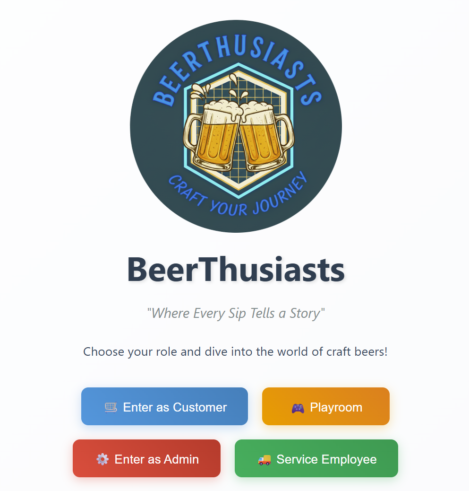
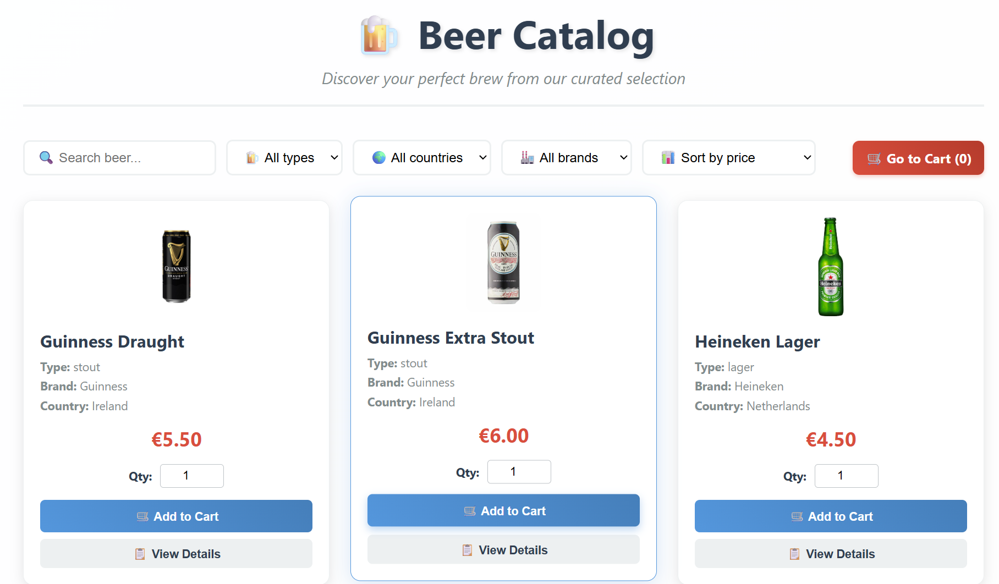
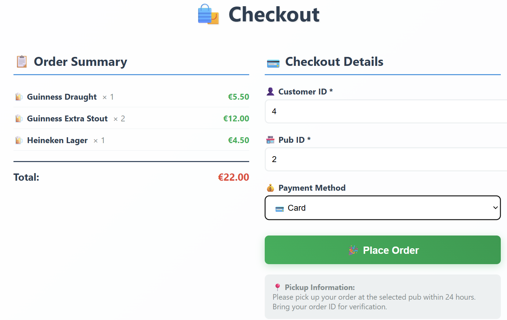
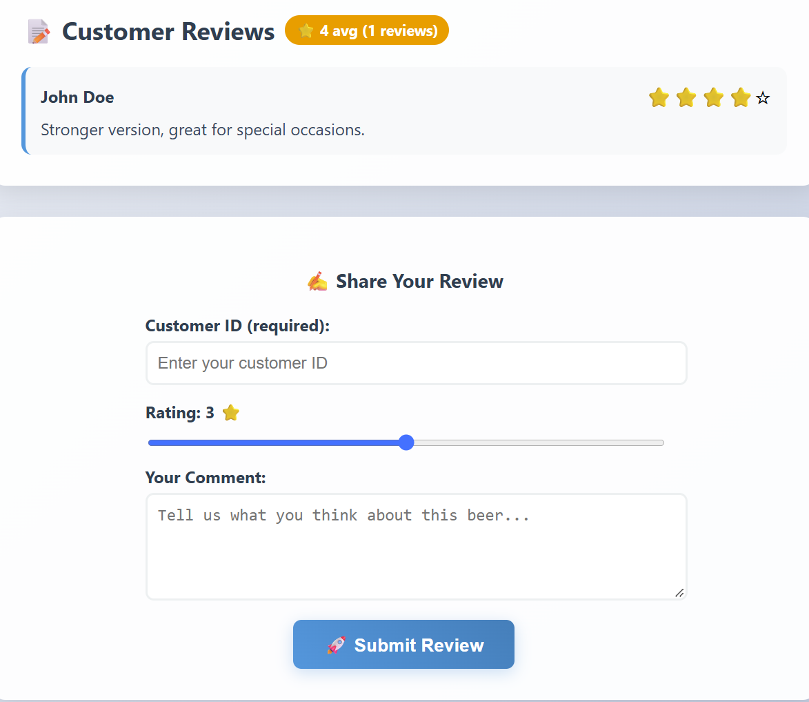
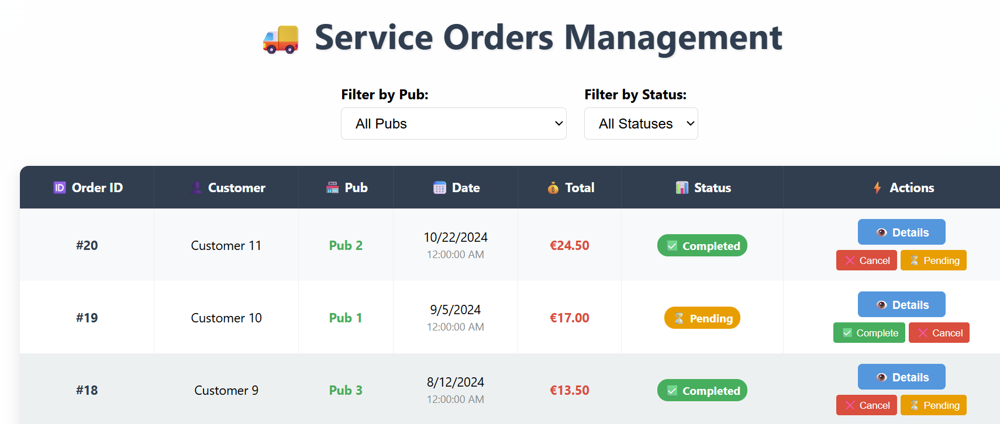
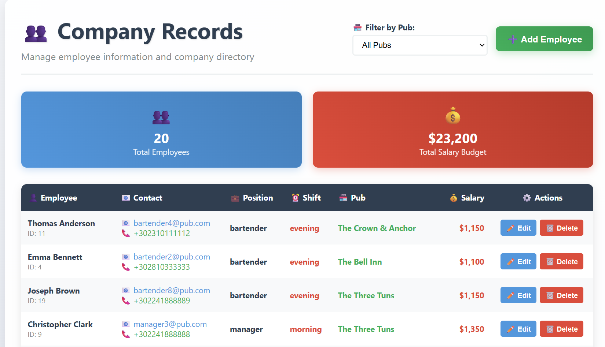

# BeerThusiasts

A full-stack craft-beer platform with three user roles:

- **Customers** browse, review and order beers.
- **Service staff** process orders against each pub's inventory.
- **Admins** manage the catalog, pubs, employees, stock and supplier orders.

**Stack:** React 19 · Node.js / Express · MySQL 8

> 🔐 **Security review:** I audited this project after building it, then fixed a path-traversal file-write bug, removed committed credentials, and cleared 9 vulnerable dependencies. Open design gaps are documented too. See **[SECURITY.md](SECURITY.md)**.

<p align="center">
  
</p>

---

## Screenshots

| **Customer:** catalog with filters | **Customer:** checkout |
|---|---|
|  |  |
| **Customer:** reviews and ratings | **Service:** order processing |
|  |  |

**Admin:** employee records



## Features

| Role | What it can do |
|------|----------------|
| **Customer** | Search and filter the catalog (brand, style, country, ABV, price) · beer detail pages · ratings and reviews · cart and checkout · loyalty points on every order |
| **Service** | View and filter orders per pub · line-item detail · complete or cancel orders, which updates pub inventory transactionally |
| **Admin** | Create and edit beers, with image upload · manage pubs and employees · inventory with reorder thresholds and a "needs restock" view · find suppliers for a brand and place supplier orders |

There's also a small tower-stacking mini-game in the **Playroom**.

## Architecture

```
React SPA (:3000)  ──fetch/JSON──▶  Express API (:5001)  ──mysql2 pool──▶  MySQL 8
  pages/ components/                 routes/ → controllers/                 12 tables, 10 views
  CartContext (localStorage)         /images/beers (static uploads)
```

- **API:** about 30 REST endpoints across `/api/beers`, `/brands`, `/reviews`, `/orders`, `/pubs` and `/admin`. All queries are parameterized.
- **Transactions:** order placement, order-status changes (with inventory adjustment) and supplier orders run inside MySQL transactions, using row locks (`SELECT ... FOR UPDATE`) where needed.
- **Schema** ([`dbDump.sql`](dbDump.sql)):
  - 12 tables with 14 foreign keys.
  - `CHECK` constraints, for example rating 0–5.
  - A generated column, `remaining_until_reorder`.
  - 10 views, for example `pubsneedrestock` and `positivebeerreviews`.

## Getting started

**Prerequisites:** Node.js 18+, and MySQL 8 running locally.

### Option A: one command (Windows / PowerShell)

```powershell
.\setup-and-launch.ps1
```

On the first run, the script creates `backend/.env` from the template and stops. Set `DB_PASSWORD` in that file, then run the script again. It then:

1. Installs dependencies.
2. Rebuilds the database with sample data.
3. Starts the API on <http://localhost:5001> and the app on <http://localhost:3000>.

> ⚠️ The script stops **all** running `node` processes before it starts the servers.

### Option B: manual

```bash
# 1. Backend
cd backend
cp .env.example .env        # then edit DB_PASSWORD
npm install
node reset_db.js            # creates the `beerthusiasts` schema and loads sample data
npm start                   # http://localhost:5001

# 2. Frontend (in a second terminal)
cd frontend
npm install
npm start                   # http://localhost:3000
```

### Configuration

| Variable | File | Default | Purpose |
|----------|------|---------|---------|
| `DB_HOST` / `DB_USER` / `DB_PASSWORD` | `backend/.env` | none | MySQL connection |
| `DB_NAME` | `backend/.env` | `beerthusiasts` | Must match the schema in `dbDump.sql` |
| `API_PORT` | `backend/.env` | `5001` | API port |
| `CORS_ORIGIN` | `backend/.env` | `http://localhost:3000` | Comma-separated origins allowed to call the API |
| `REACT_APP_API_BASE` | `frontend/.env` | `http://localhost:5001` | API URL used by the frontend |

`node reset_db.js` resets the database to the sample data at any time. It is **destructive**: it drops and recreates the schema.

## Project structure

```
BeerThusiasts/
├── backend/
│   ├── src/
│   │   ├── app.js            # Express setup: CORS, JSON limits, routes, static images
│   │   ├── db.js             # mysql2 connection pool
│   │   ├── routes/           # URL → controller mapping (+ upload validation in admin.js)
│   │   └── controllers/      # Query and business logic per resource
│   ├── reset_db.js           # Rebuilds the schema and loads dummy_data.sql
│   ├── dummy_data.sql        # Sample data
│   └── .env.example          # Config template (the real .env is gitignored)
├── frontend/
│   └── src/
│       ├── pages/            # Route-level screens (catalog, cart, admin, service, ...)
│       ├── components/       # BeerCard, Filters, AddBeerForm, UploadImageForm, towerGame/
│       ├── context/          # CartContext
│       └── api/beer.js       # All API calls in one place
├── dbDump.sql                # Full schema: tables, constraints, views
├── setup-and-launch.ps1
└── SECURITY.md               # Security self-review
```

## Known limitations

- **No authentication yet.** The role is picked on the home page and stored client-side, and the API does not check it. This is the top item in [SECURITY.md](SECURITY.md#open-issues), along with the planned JWT + bcrypt design.
- No automated test suite yet.

## Credits

- The review form (rating input, comment box, submit flow) was adapted from open-source examples whose license is not stated: [RichardFoil/milestone3](https://github.com/RichardFoil/milestone3/blob/f4a322acc612727866a59de59454beda3334a86c/frontend/src/CommentRatingForm.js), [rishavgn/tensorassg](https://github.com/rishavgn/tensorassg/blob/9c3f02aa179c3a4f9a348f8a97d8035fb211959d/client/src/screens/FeedbackForm.jsx), [mcshanebrendan/my-app](https://github.com/mcshanebrendan/my-app/blob/75e763305873a195b24e5c8611c20d4008d7ae29/src/components/reviews.js).
- I used AI coding assistants during development for scaffolding, debugging and documentation.

## License

Educational and portfolio use.
